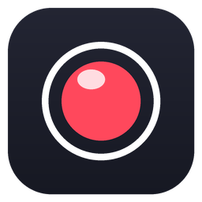
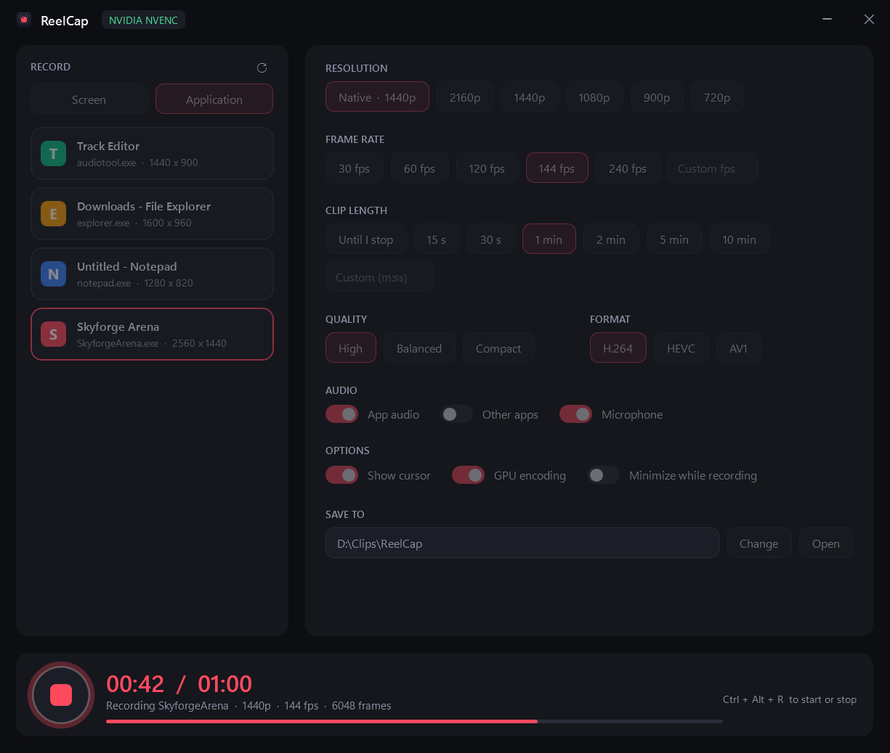
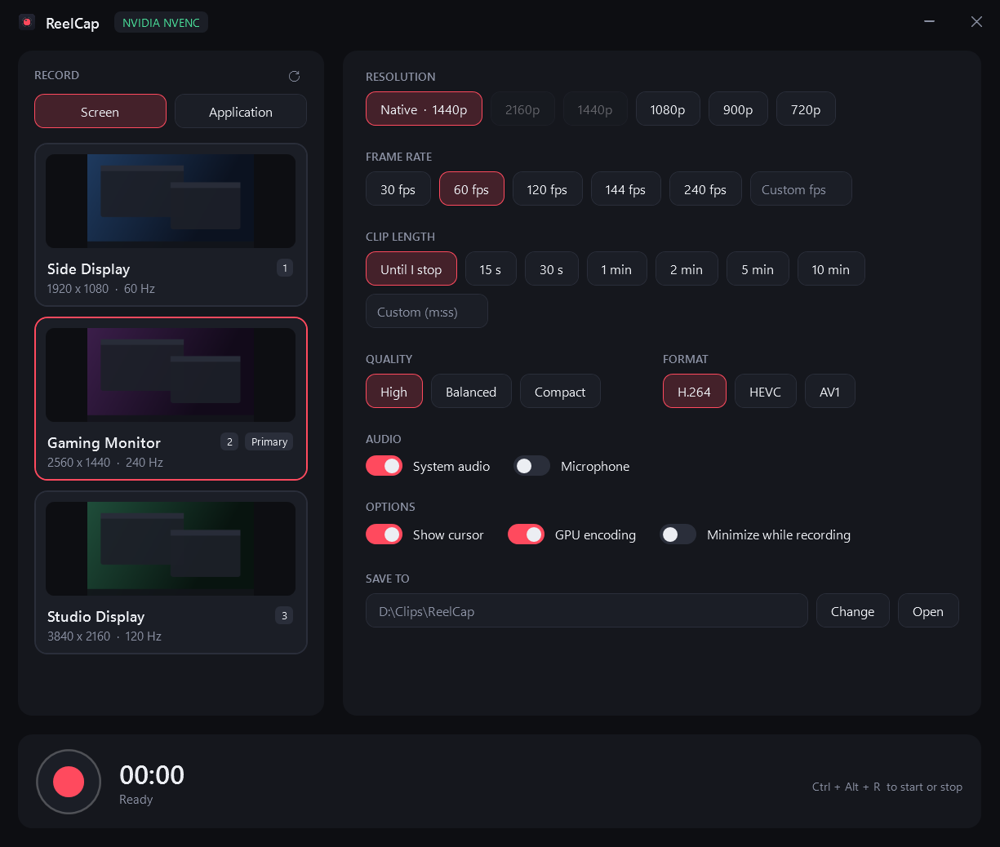
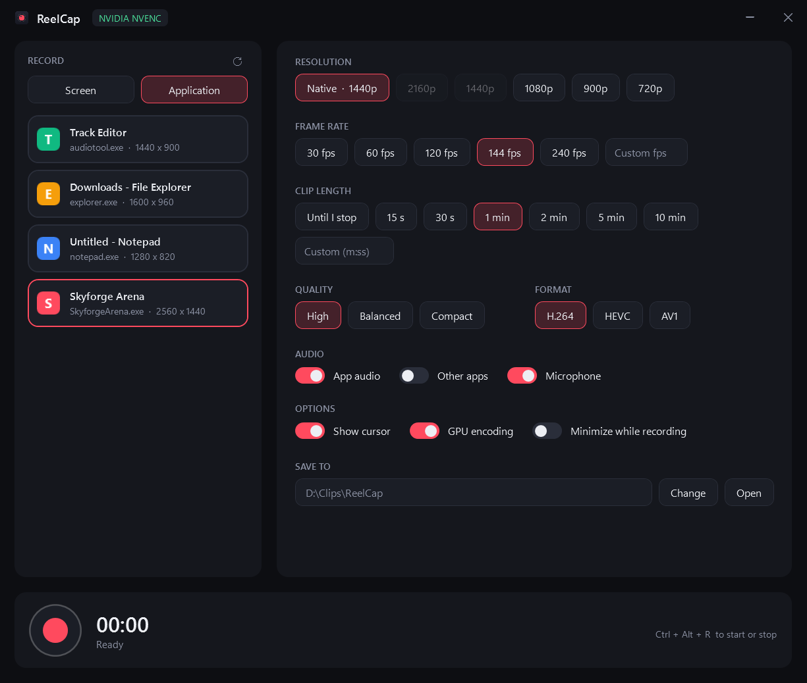

<p align="center"></p>

<h1 align="center">ReelCap</h1>

<p align="center">A small, fast screen recorder for Windows game clips. Record one game window or a whole monitor, with the game's own audio, using GPU encoding that barely touches the CPU.</p>

<p align="center"></p>

## Features

- **Record a single application or a whole monitor.** Pick a window from the Application list (games included) or a display from the Screen list, with live previews.
- **Audio from the sources you choose, mixed into one track:**
  - **App audio:** only the recorded application's own sound. Record a game and you get the game, not your music or chat.
  - **Other apps:** everything except the recorded application.
  - **System audio:** everything that plays (Screen mode).
  - **Microphone.**
- **Low impact on the game.** Captured frames go straight from Windows Graphics Capture into NVENC as GPU textures, never copied through system memory.
- **Survives display changes.** If the capture drops (a game switching display modes, alt-tab out of fullscreen, a UAC prompt), recording resumes on its own. The gap shows as a held frame and the audio carries on.
- **Output options:**
  - **Resolution:** native, or scaled on the GPU to 2160p, 1440p, 1080p, 900p or 720p.
  - **Frame rate:** 30, 60, 120, 144 or 240 fps, or any custom value.
  - **Clip length:** until you stop it, a preset length, or a custom m:ss.
  - **Quality:** High, Balanced or Compact.
  - **Format:** H.264, HEVC or AV1.
- **Global hotkey:** Ctrl+Alt+R starts and stops recording from anywhere, including in game.
- **Output:** MP4 files in `Videos\ReelCap` by default. "Play last clip" and "Open" are one click away.

<p align="center">
  
  
</p>

The screenshots are rendered by the app itself (`--screenshot`) with made-up monitors and windows.

## Requirements

- Windows 10 version 2004 or later, or Windows 11. Per-application audio capture needs 2004+.
- [.NET 9 Desktop Runtime](https://dotnet.microsoft.com/download/dotnet/9.0).
- [FFmpeg](https://ffmpeg.org/) 8.1 or later with the `gfxcapture` filter. The Gyan full build works: `winget install Gyan.FFmpeg`. ReelCap looks for `ffmpeg.exe` and `ffprobe.exe` next to `ReelCap.exe`, then on `PATH`, then in the winget packages folder.
- For the zero-copy path, an NVIDIA GPU with NVENC. AMD AMF, Intel Quick Sync and CPU encoders are used when NVENC is missing (see the testing notes below).

## Install

1. Download `ReelCap.zip` from [Releases](../../releases) and unzip it anywhere.
2. Install FFmpeg (above), or copy `ffmpeg.exe` and `ffprobe.exe` next to `ReelCap.exe`.
3. Run `ReelCap.exe`. Optionally pin it, or make a desktop shortcut.

Build from source:

```
cd src
dotnet publish -c Release -o ../dist
```

The icon is generated with `python tools/make_icon.py src` (needs Pillow).

## How it works

```
Window or monitor ──► gfxcapture (Windows Graphics Capture, GPU scaled) ──► NVENC ──► video segment(s) ─┐
App / other / system / mic ──► WASAPI ──► in-app mixer (QPC timeline) ──► AAC ──► audio track ──────────┴─► MP4
```

- **Video.** Each capture run is one ffmpeg process with the `gfxcapture` source, selected by window handle or monitor handle. With NVENC there is no `hwdownload`: NVENC converts BGRA to YUV on the GPU. It uses the BT.601 matrix, so streams are tagged `smpte170m` explicitly; the capture marks frames as RGB, which would otherwise make players show the wrong colours.
- **Audio.** Every input is captured by WASAPI (process loopback for app and other-apps audio) as 48 kHz stereo float. Packets are placed on the recording's timeline by their QPC timestamps:
  - Silent stretches stay silent.
  - Device clock drift is corrected one sample at a time, not with audible jumps.
  - There are no allocations per packet.
  - The mixer runs 250 ms behind real time so late packets still land, and streams to one long-lived ffmpeg (limiter, AAC 192 kbps).
- **Timeline and recovery.** Audio and video share one time zero. Each video run logs its first frame's offset from that zero. If a run ends unexpectedly, the next one starts within about 0.1 s. At stop, the runs are placed at their offsets (a lost stretch holds the last frame) and muxed with the continuous audio into one MP4 without re-encoding. Video runs are written as MKV, flushed every second, so a crash loses at most about a second.

## Performance

Measured on one machine (RTX 5090, Windows 11), capturing a 2560x1440 monitor with a 120 to 240 fps target, H.264 NVENC preset p5:

| Path | ffmpeg CPU time per 6 s of capture |
| --- | --- |
| GPU texture straight into NVENC (what ReelCap uses) | 0.2 to 0.5 s (about 6% of one core) |
| Download to system memory, then encode | 3.0 to 4.8 s (50 to 80% of one core) |

Windows Graphics Capture only delivers frames when the screen changes; the output is constant frame rate, with repeats filled in by ffmpeg.

## Testing

### What the project has

- `ReelCap.exe --selftest out.txt [exe]` is an end-to-end check with no window shown:
  - It lists displays and the encoders ffmpeg can open.
  - It records the primary monitor for 3 s with system audio.
  - Given an exe name, it records that application's window for 6 s with its own audio, killing the capture at 2.5 s to exercise recovery.
  - It writes a report to `out.txt` and the clips next to it. Set `REELCAP_KEEP=1` to keep the intermediate parts and a mixer trace.
- `ReelCap.exe --screenshot out.png [app] [rec]` renders the UI off-screen with made-up data. It is how the screenshots here were made.
- The app checks which hardware encoders actually open at startup and falls back to the next one.

There are **no unit tests and no CI**. The checks above were run by hand on one machine.

### What has been tested

On Windows 11 with an RTX 5090, an AMD integrated GPU, three monitors (1920x1080 60 Hz, 2560x1440 144 Hz, 2560x1440 360 Hz), FFmpeg 8.1.2 (Gyan full build) and .NET 9:

- **Monitor capture:** the primary monitor through the app (the self-test, four runs). Two monitors by index in the benchmark above. Output length and frame rate as configured.
- **Window capture:** a browser window (1920x1080) with only that browser's audio, through process loopback.
- **Recovery:** with the capture killed mid-recording, the clip resumed. The second part landed at the right time, and the audio stayed continuous for the full 6 s.
- **Audio/video alignment by timestamps:**
  - Audio starts at the recording's time zero.
  - Video starts 0.17 to 0.21 s later, which is capture startup and matches across runs.
  - Audio length matches the session length.
- **Colour:** NVENC's RGB to YUV conversion was measured (BT.601, limited range). A tagged stream decodes back to the source colour.
- **Encoders:** NVENC H.264 was used for every recording test. Detection found NVENC H.264, HEVC and AV1, plus AMF H.264 and HEVC.
- **CPU cost:** the zero-copy path versus the download path, measured as in the table above.
- **UI:** rendered in both modes and in the recording state, at 125% display scaling.

### What has not been tested yet

- **A real exclusive fullscreen mode switch in a game.** Recovery was tested by killing the capture, not by an actual mode change.
- **Audio/video sync by content,** for example a clap or a flash against its sound. Alignment has only been checked by timestamps.
- **Encoding paths other than NVENC H.264:** HEVC, AV1, AMD AMF, Intel Quick Sync and the CPU encoders. None of these have been used for a real recording.
- **Some audio inputs:** the microphone, and "Other apps" (process loopback excluding the target).
- **Long recordings** (over a few minutes), low disk space, or a full disk.
- **Window edge cases:** a window resized, minimised or moved between monitors mid-recording. Also games whose audio comes from a separate process (only the target's process tree is captured).
- **Anti-cheat protected games,** HDR displays, monitors with display scaling other than 125%, and multiple GPUs other than the one setup above.
- **Clicking through the UI:** the global hotkey, the folder picker, and settings persistence are not covered by any automated check.
- **Windows 10.**

## Not supported (yet)

- **Recording workflow:**
  - Replay buffer ("save the last 30 seconds"), pause and resume, region capture.
  - Separate audio tracks per source, per-source volume.
- **Overlays and output:**
  - Webcam or overlays, live streaming.
  - HDR capture (frames are captured as 8-bit SDR).
- **Hotkeys and UI:**
  - Rebinding the hotkey. The fixed Ctrl+Alt+R fails silently if another app already holds it.
  - A tray icon.
- **Distribution:** an installer, auto-update, code signing (Windows SmartScreen may warn on first run), bundled FFmpeg.
- **Other platforms:** macOS and Linux.

## Project layout

```
src/
  MainWindow.xaml(.cs)  UI
  Recorder.cs           ffmpeg capture runs, recovery, final mux
  Audio.cs              WASAPI inputs, QPC timeline, mixer
  Monitors.cs           monitor enumeration (DXGI, display config) and previews
  Windows.cs            application window enumeration
  Settings.cs           settings (%APPDATA%\ReelCap\settings.json)
  DemoData.cs           made-up data for screenshots
tools/make_icon.py      icon generator
docs/                   screenshots
```

## License

MIT, see [LICENSE](LICENSE). ReelCap calls FFmpeg as a separate program and does not include it; FFmpeg is licensed under the LGPL or GPL depending on the build. Audio capture uses [NAudio](https://github.com/naudio/NAudio) (MIT).
